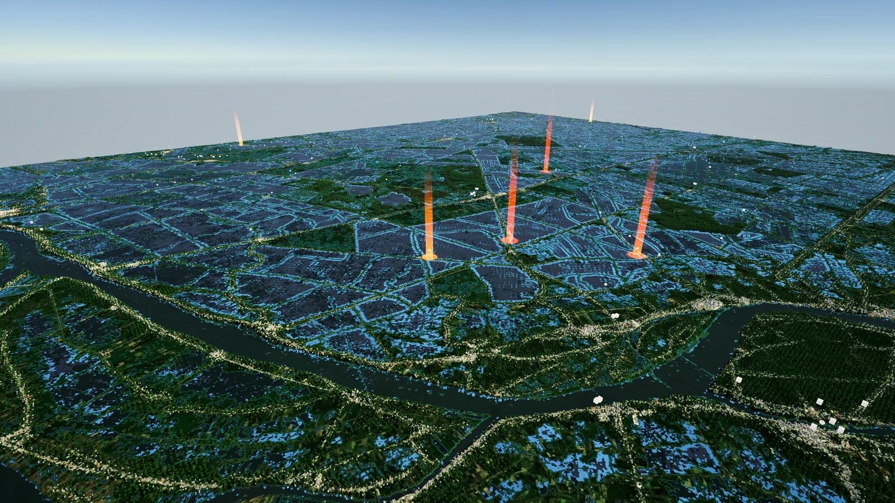
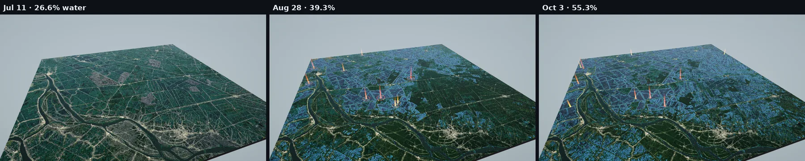
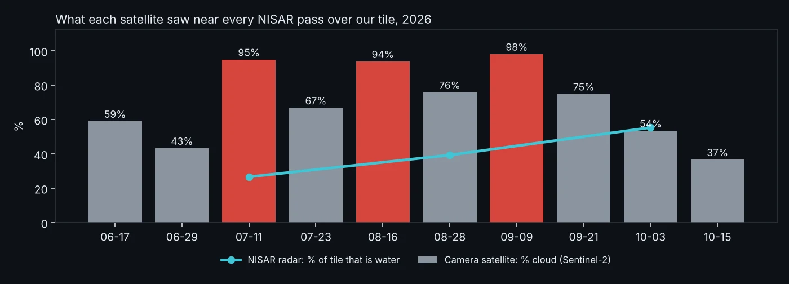
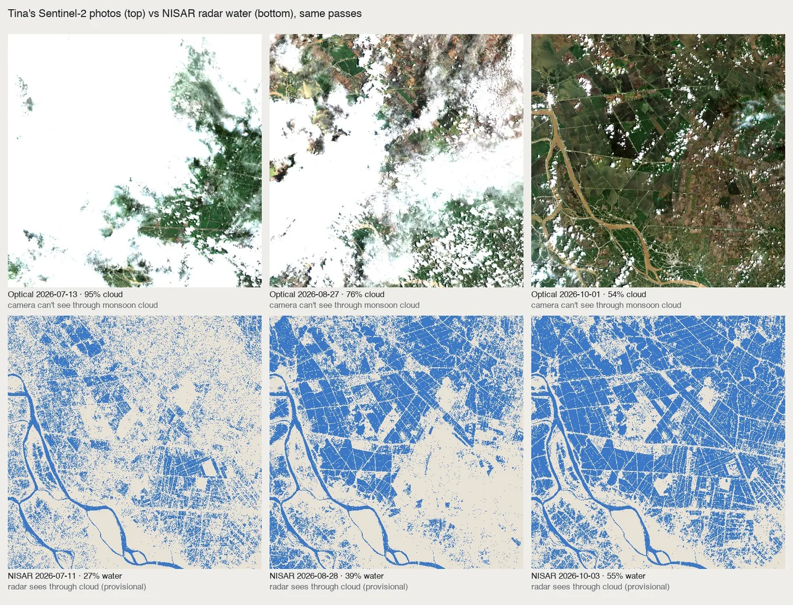

# Ourea · every NISAR pass, a plain answer

**NASA Space Apps Challenge 2026 · Dancing with the SARs · Team Ourea (NYC)**

Every flood season, children in Vietnam's Mekong Delta drown in the water that rises around their homes, and the flood arrives under monsoon clouds that blind camera satellites. **Ourea turns each NISAR L-band radar pass into a plain answer for the people who keep children safe: where is flood water now close to homes, schools and young children, and which communes should we check first?**



## What we found (real NISAR data, 2026)

Over a 4,006 km² tile of the upper delta (105.30–105.90°E, 10.40–10.95°N, Đồng Tháp / An Giang / Tây Ninh):

| | |
|---|---|
| Open water on the tile | **26.6%** (Jul 11) → **39.3%** (Aug 28) → **55.3%** (Oct 3) |
| New water since July | **≈1,335 km²** |
| Children under 5 living within ~100 m of new flood water | **≈28,100** (of ≈81,100 on the tile) |
| Schools near flood water | **18 of 94** mapped |
| Communes ranked every pass | **192** (#1 on Oct 3: Xã Vĩnh Châu, 488 of 538 under-5s near flood water) |
| Ranking robustness | every weight ±50% keeps 3–5 of the top 5 and 7–10 of the top 10 |



## Why radar

On the days NISAR passed, the camera satellite (Sentinel-2) saw on average about **70% cloud**, and **94–98%** on Jul 11, Aug 16 and Sep 9, right as the flood built up. L-band radar sees the water through cloud and between rice stalks.





## How it works

```
NISAR L2 GCOV (HH, HV) ──► pipeline/   download (ASF), reproject to UTM 48N, 2048² grid (~31 m)
                                │
                                ▼
                         science/   water rule (HH < −13 dB) · rice-vs-flood rule · check-first score
                                │        + WorldPop under-5 · OpenStreetMap homes & schools · commune boundaries
                                ▼
                     handoff/findings/  scores.json · commune_scores.json · headline.json · receipts.json
                                │
                                ▼
            Cloudflare Worker API (ourea-api.team-ourea.workers.dev)
                                │
                                ▼
                    unity/  Unity 6 WebGL scene  ──►  web/public/unity (playable build)
```

**Check-first score** (per commune, per pass), every factor scaled 0–1:

`score = 100 × (0.35 · water near homes + 0.25 · young children + 0.20 · new water since last pass + 0.20 · schools near water)`

Each commune shows its reasons, e.g. *"about 488 of 538 children under 5 live within ~100 m of flood water · 91% of homes have flood water within ~100 m"*.

## Try it

- **Playable build:** `web/public/unity` (Unity WebGL). Locally: `cd web/public/unity && python3 -m http.server 8000`, then open http://localhost:8000
- **In the app:** scrub the timeline to watch the flood spread; open **Compare** to wipe between the cloudy camera photo and the radar; open **Communes** for the ranked list and the reasons behind each rank.
- **Rebuild the data:** `pipeline/run_pipeline.py` (NISAR), `pipeline/make_heightmap.py` (terrain), `pipeline/make_optical.py` (Sentinel-2), then `science/score.py` and `science/commune_score.py`.

## What's real, what's modeled

Every number on screen traces to a file in `handoff/`. The full list, including what is modeled (the "what if" water-level slider) and what is fictional (the story guide), is in [`docs/SOURCES.md`](docs/SOURCES.md).

**Limits we state openly:** NISAR data is provisional. The water rule is a threshold. Rice fields flooded on purpose are not yet separated from river flood, because that rule needs passes 12 days apart and we have processed three passes six weeks apart. Canals narrower than ~30 m are missed. OSM school coverage is incomplete, and WorldPop counts are modeled. 2026 was a low-flood year. Ourea targets protection that already exists (flood-season childcare points, swim classes); it does not see children or prevent drownings by itself.

## Data

| Data | Use |
|---|---|
| **NISAR L2 GCOV** (provisional), track 047 desc., frame 083, via ASF | Water maps, radar view |
| Sentinel-2 L2A (Element 84 Earth Search) | Camera-vs-radar comparison, cloud % |
| Sentinel-2 cloudless 2024 (EOX, CC BY-NC-SA 4.0) | Ground colour in the 3D view |
| Copernicus GLO-30 DEM · FABDEM | Terrain, flood depth |
| WorldPop 2026 age/sex structures (100 m) | Children under 5 |
| OpenStreetMap (ODbL) | Homes, schools, places |
| GHS-BUILT (EU JRC) · ETH Global Canopy Height | 3D buildings, trees |

## Repo layout

| Folder | Owner | What lives here |
|---|---|---|
| `pipeline/` | Eric, Tina | NISAR download and regridding, terrain, Sentinel-2 photos |
| `science/` | Mitch | Water rule, rice-vs-flood rule, check-first score, sensitivity test |
| `unity/` | Kason, Tina | Unity 6 project (URP, WebGL) |
| `web/` | Asher, Kason | Cloudflare API, playable WebGL build |
| `handoff/` | everyone | The data contract between pipeline, science and Unity ([`CONTRACT.md`](handoff/CONTRACT.md)) |
| `docs/` | Christopher, all | Stills, sources, AI-use log |

## Team

Tina Tran (lead) · Kason Lin (Unity) · Eric Li (data) · Mitch Cahill (science) · Asher Lee (web & data layers) · Christopher Hsu (slides & story)

## License

MIT
